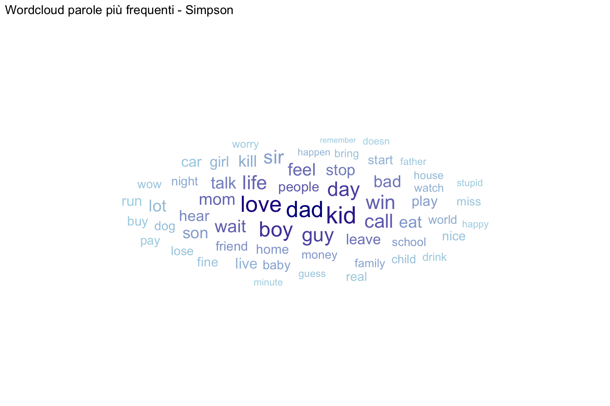
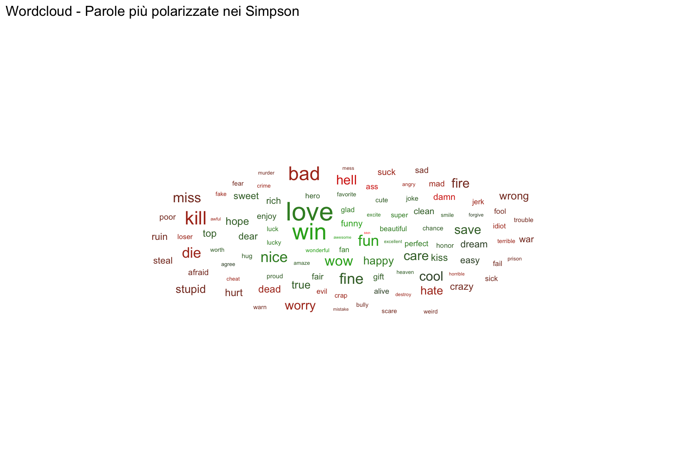
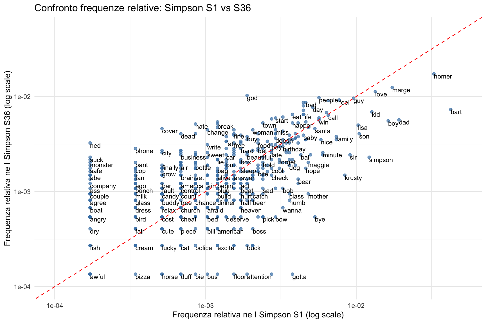
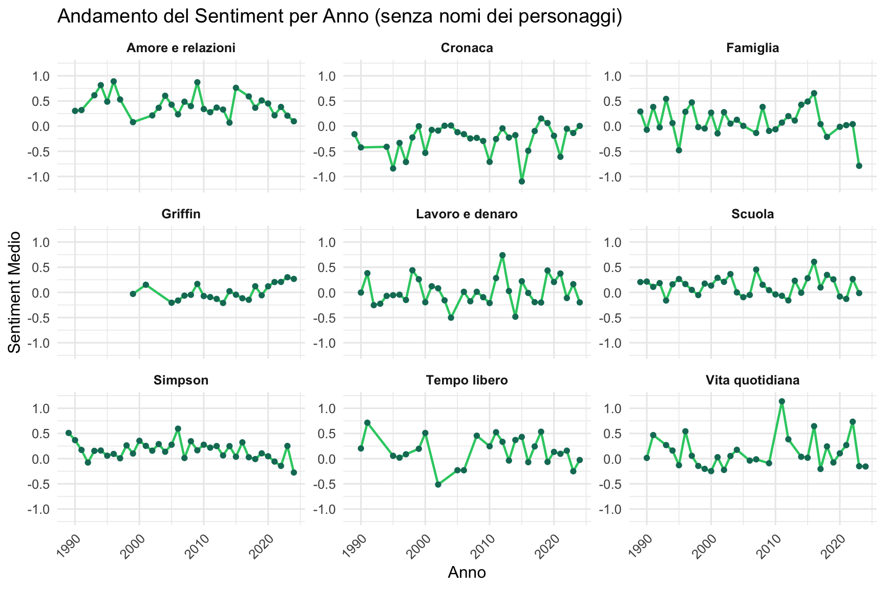

# Analisi testuale comparativa: *I Simpson* vs *I Griffin*

🇮🇹 **Italiano** · 🇬🇧 [English](README.en.md)

Analisi di **text mining**, **topic modeling** e **sentiment analysis** sui dialoghi
degli episodi di due tra le più longeve sitcom animate americane, *I Simpson* e
*I Griffin* (*Family Guy*), per esplorarne in chiave comparativa somiglianze,
differenze e l'evoluzione nel tempo.

> Progetto sviluppato in **R** nell'ambito di un corso magistrale di analisi dei
> *social media* / *text mining* (2025).

---

## Contesto e obiettivo

Le due serie condividono *format* e pubblico ma differiscono per stile, linguaggio e
tono. Il progetto quantifica queste differenze partendo dai testi delle sceneggiature,
raccolti via *web scraping* e analizzati lungo tre direttrici:

- **Text mining**: frequenze, n-grammi, *keyness*, associazioni tra termini;
- **Topic modeling**: *Latent Dirichlet Allocation* (LDA) e *Structural Topic
  Modeling* (STM) con covariate (serie, anno, presidente USA in carica, produttore);
- **Sentiment analysis**: polarità dei dialoghi, per serie, stagione e *topic*, con
  correlazione ai *rating* IMDb.

## Dataset

| | |
|---|---|
| **Fonte testi** | [springfieldspringfield.co.uk](https://www.springfieldspringfield.co.uk) (trascrizioni episodi) |
| **Fonte rating/trame** | [IMDb](https://www.imdb.com) |
| **Dimensione** | **1.216 episodi** (784 de *I Simpson*, 432 de *I Griffin*) |
| **Copertura** | *I Simpson* stagioni 1–36 (1989–2024), *I Griffin* stagioni 1–23 |
| **Lingua testi** | inglese |

> ⚠️ **I dati non sono inclusi nel repository.** Le trascrizioni sono materiale
> protetto da copyright: viene condiviso solo il **codice** che le raccoglie ed
> elabora. Tutti i `.RData` sono rigenerabili dagli script, vedi
> [`data/README.md`](data/README.md).

## Metodo

1. **Raccolta** (`R/01_scraping.R`): scraping dei copioni e dei metadati IMDb.
2. **Pre-processing** (`R/02_preprocessing.R`): rimozione di sigle, didascalie,
   voci fuori campo ed errori OCR; *tokenizzazione*, *lemmatizzazione*, rimozione di
   *stopword* (lista standard integrata con lista personalizzata di nomi dei personaggi).
3. **Analisi**: text mining (`R/03_text_mining.R`, `R/07_associations.R`), topic
   modeling (`R/04_lda.R`, `R/05_stm.R`) e sentiment analysis (`R/06_sentiment.R`).
4. **Report**: l'intera analisi è documentata in modo narrativo in
   [`report/progetto_completo.Rmd`](report/progetto_completo.Rmd) (con appendici su
   scraping e funzioni).

I *seed* sono fissati (`set.seed(42)`) dove la casualità influenza i risultati.

## Risultati

Alcune evidenze principali (i dettagli completi sono nel report):

**Differenze linguistiche.** *I Griffin* usano un registro più trasgressivo
(*hell*, *damn* molto più frequenti); *I Simpson* mantengono un tono più neutro e
*family-friendly*.

<p align="center">
  
  
</p>

**Evoluzione dei personaggi.** Confrontando la prima e l'ultima stagione de *I
Simpson* emerge il passaggio da **Bart** a **Homer** come figura centrale (in linea
con quanto dichiarato dal creatore Matt Groening).

<p align="center">
  
</p>

**Topic modeling.** La LDA individua **9 macro-temi** comuni alle due serie: vita
familiare, relazioni sentimentali, intrattenimento e media, festività natalizie,
eventi anomali, ambiente scolastico, lavoro e denaro, matrimonio, politica e
attualità, trattati però con toni diversi (più cinici nei Griffin). La STM rivela
effetti temporali non lineari.

**Sentiment.** *I Simpson* mostrano un sentiment mediamente più **positivo e stabile**;
*I Griffin* oscillano su valori più bassi, con però una tendenza al miglioramento nelle
stagioni recenti.

<p align="center">
  
</p>

> 📄 Il report completo con tutti i grafici è
> [`report/progetto_completo.html`](report/progetto_completo.html) (scaricabile e
> apribile nel browser).

## Come riprodurre

Requisiti: **R ≥ 4.2**. Installa i pacchetti elencati in
[`requirements-R.txt`](requirements-R.txt):

```r
pkgs <- readLines("requirements-R.txt")
pkgs <- pkgs[!grepl("^\\s*#|^\\s*$", pkgs)]
install.packages(setdiff(pkgs, rownames(installed.packages())))
```

Poi esegui gli script nell'ordine numerico (creano i `.RData` in `data/`):

```
R/01_scraping.R  →  R/02_preprocessing.R  →  R/03_text_mining.R
R/04_lda.R  →  R/05_stm.R  →  R/06_sentiment.R  →  R/07_associations.R
```

Infine, per rigenerare il report:

```r
rmarkdown::render("report/progetto_completo.Rmd")
```

> ⚠️ Il report carica oggetti `.RData` pre-calcolati (i modelli LDA/STM sono
> computazionalmente onerosi). Per una riproduzione completa da zero occorre prima
> eseguire gli script della *pipeline* sopra, che li generano.

## Struttura del repo

```
.
├── R/                      # pipeline di analisi (script numerati)
│   ├── 01_scraping.R         # raccolta copioni + rating IMDb
│   ├── 02_preprocessing.R    # pulizia e pre-processing del testo
│   ├── 03_text_mining.R      # frequenze, n-grammi, keyness
│   ├── 04_lda.R              # Latent Dirichlet Allocation
│   ├── 05_stm.R              # Structural Topic Modeling
│   ├── 06_sentiment.R        # sentiment analysis (serie / topic / tempo)
│   └── 07_associations.R     # associazioni tra termini
├── report/
│   ├── progetto_completo.Rmd   # report riproducibile (fonte)
│   └── progetto_completo.html  # report renderizzato
├── figures/                # grafici selezionati per il README
├── data/                   # vuota: i dati si rigenerano (vedi data/README.md)
├── index.html              # landing page per GitHub Pages (link al report)
├── requirements-R.txt      # pacchetti R
├── LICENSE                 # MIT
└── README.md
```

## Tecnologie

**R** · `tidyverse` · `tidytext` · `quanteda` · `tm` · **topic modeling**
(`topicmodels`, `stm`, `lda`, `ldatuning`, `LDAvis`) · **sentiment** (`textdata`) ·
**scraping** (`rvest`, `httr`) · **visualizzazione** (`ggplot2`, `ggwordcloud`,
`wordcloud`) · **R Markdown**.

## Autori

Progetto di gruppo di **Giorgia Caicchiolo, Daniele Carollo, Gabriele Paganelli,
Riccardo Pati, Giorgia Tossici**.

## Licenza

Codice distribuito con licenza [MIT](LICENSE). I testi degli episodi analizzati non
sono inclusi e restano di proprietà dei rispettivi detentori dei diritti.
